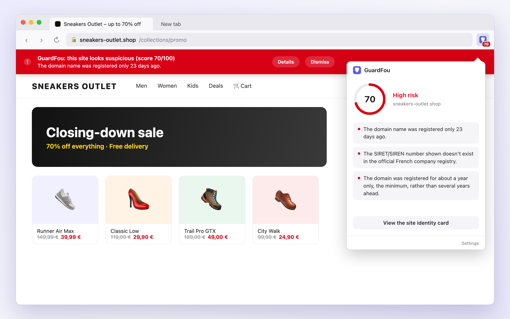

# GuardFou

**A safeguard against fake online shops.**

GuardFou is a Firefox extension that warns you when an online shop looks fake: a site impersonating a known brand, a domain registered a few weeks ago, missing or fabricated company information.



It currently targets **France**. Some checks work on any website; others rely on French law, the French company registry and a list of French retailers (see [Scope](#scope)).

## How it works

On every page you visit, GuardFou computes a risk score from 0 to 100:

| Score | Badge | Meaning |
|---|---|---|
| 0–29 | none | Looks fine |
| 30–59 | orange | Be careful |
| 60–100 | red | High risk, and a warning banner appears on the page |

Click the toolbar icon to see the reasons behind the score, or open the **site identity card** for a detailed look at any page: domain dates, registrar, company details, legal information found, technologies used, social links.

No single check proves a site is a scam. The score combines them, and every reason is shown to the user.

## Scope

### Checks that work on any website

- **Domain age**: domains created in the last few months are a classic sign of short-lived scam shops. Domains registered for a single year, or through registrars often seen on scam shops, add weight when the domain is also new. Checked automatically on shops; a setting extends it to every site.
- **Suspicious URLs**: raw IP addresses, `user@host` tricks, "https" written into the domain name, unencrypted HTTP.
- **DNSSEC**: flags domains whose DNS signatures are invalid.
- **Shared hosting**: recognises shops on platform subdomains (`*.myshopify.com`, `*.wixsite.com`…), which have no domain of their own to check.

### France-specific checks

- **Brand impersonation**: the site presents itself as a known French retailer (Leroy Merlin, Fnac, Decathlon…) but isn't on that brand's official domain, or its domain imitates the official one with a word added (`decathlon-outlet.com`) or a typo (`decathllon.fr`). The detection itself is generic; only the brand list, in `src/data/brands-fr.js`, is French.
- **Mandatory legal information**: French law (LCEN) requires every site to publish its company name, SIRET number, registered address, host and contact details. GuardFou reads the site's legal notice and terms of sale pages and lists what's missing.
- **SIRET/SIREN numbers**: checks that the company number is well-formed, exists in the official French registry, belongs to an active company, and matches the name the site uses.
- **Shop detection**: looks for prices in euros and cart wording in French or English (product structured data works for any language).

### Language

The interface (popup, settings, warning banner) is available in English and French, and follows Firefox's language, falling back to English. To add a language, copy `_locales/en/messages.json` to `_locales/<code>/messages.json` and translate the messages; the tests check that every locale has the same keys and substitutions.

## Privacy

GuardFou has no server and no analytics. To run its checks it contacts:

| Service | What is sent | Why |
|---|---|---|
| [rdap.org](https://rdap.org), which forwards to the registry of the domain's extension | The site's domain name | Registration date and registrar |
| [Cloudflare DNS](https://developers.cloudflare.com/1.1.1.1/encryption/dns-over-https/) | The site's domain name | DNSSEC status |
| [recherche-entreprises.api.gouv.fr](https://recherche-entreprises.api.gouv.fr) | The company number shown on the site | French company registry lookup |
| The site itself | A normal page request, without your cookies | Reading its legal pages |

These lookups only run on pages that look like shops or name a known brand, or when you open the identity card yourself. If you turn on domain-age checks for every site in the settings, the domain of every site you visit (except those on your trusted list) is sent to rdap.org. Results are cached on your computer for 7 days, so each domain is looked up at most once a week; you can clear the cache or turn it off in the settings.

## Install

1. Install GuardFou from [addons.mozilla.org](https://addons.mozilla.org/firefox/addon/guardfou/) (Firefox 140 or later; 142 on Android).
2. Click the GuardFou icon and press the activation button to let it read the pages you visit.

## Development

Requires Node.js 22+ and Firefox.

```sh
npm ci          # install dependencies
npm start       # launch Firefox with the extension loaded
npm test        # run the unit tests
npm run lint    # validate the extension with Mozilla's linter
npm run build   # build an unsigned web-ext-artifacts/guardfou-<version>.xpi
```

An unsigned `.xpi` can be loaded temporarily from `about:debugging`, or installed in Firefox Developer Edition with `xpinstall.signatures.required` set to `false`.

### Project layout

```
src/content/      reads the page (title, links, prices…) and shows the warning banner
src/background/   runs the network lookups and keeps each tab's verdict
src/core/         pure logic: scoring, brand matching, legal-information and SIRET checks
src/data/         known brands and their official domains, watched registrars
src/popup/        toolbar popup and identity card
src/options/      settings page
src/shared/       styles and the page translation helper
_locales/         interface text, one messages.json per language
tests/            unit tests for src/core (node --test)
```

Most of the detection logic lives in `src/core/` as plain functions with no browser APIs, so it can be tested without Firefox.

### Releasing

Every push and pull request runs the tests and lint and builds an unsigned `.xpi` (see the workflow run's artifacts).

To publish a signed release:

1. Bump `version` in `manifest.json` and commit.
2. Tag and push: `git tag v0.2.0 && git push --tags`.

The workflow checks that the tag matches the manifest version, submits that version to addons.mozilla.org and creates a GitHub Release with the unsigned build. Mozilla reviews each version before publishing it on the store, which can take a few days. It needs two repository secrets, `AMO_JWT_ISSUER` and `AMO_JWT_SECRET`, created at [addons.mozilla.org/developers/addon/api/key](https://addons.mozilla.org/developers/addon/api/key/).

The store listing (summary, description, categories, licence) comes from `amo-metadata.json` and is sent again with every release, so edit it there rather than on the Developer Hub.

## Roadmap

- Community reports: let users flag scam sites and vouch for trusted ones.
- More brands in `src/data/brands-fr.js`; contributions welcome.
- Support for other countries: brand lists, company registries and legal requirements.
- Site popularity and backlinks in the identity card.

Store listing material lives next to the code: `amo-metadata.json` (listing text, sent with every release), `PRIVACY.md` (privacy policy) and `store/` (screenshots).

## License

Copyright (c) 2026 Guillaume Drevet. Licensed under the [Apache License 2.0](LICENSE); see [NOTICE](NOTICE) for attributions.
