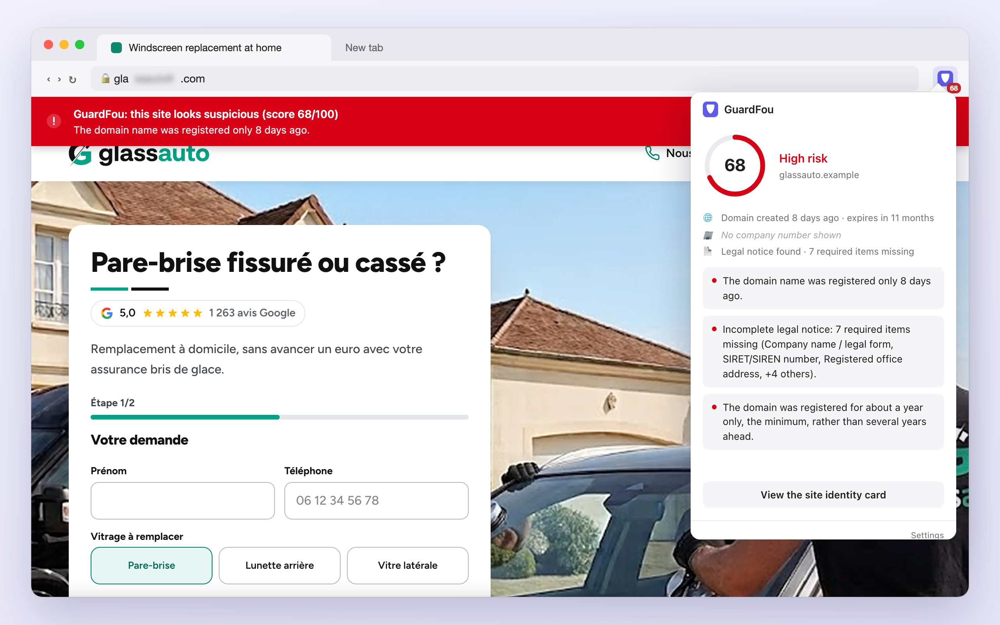

# GuardFou

**A safeguard against fake online shops.**

GuardFou is a browser extension for Firefox and Chrome that warns you when an online shop looks fake: a site impersonating a known brand, a domain registered a few weeks ago, missing or fabricated company information.



It currently targets **France**: some checks work on any website, others rely on French law, the French company registry and a list of French retailers (see [Scope](#scope)).

## How it works

On every page you visit, GuardFou computes a risk score from 0 to 100:

| Score | Badge | Meaning |
|---|---|---|
| 0–29 | none | Looks fine |
| 30–59 | orange | Be careful |
| 60–100 | red | High risk, and a warning banner appears on the page |

Click the toolbar icon to see the reasons behind the score, or open the **site identity card** for details: domain dates, registrar, company, legal information, technologies, social links.

No single check proves a site is a scam; the score combines them and shows every reason.

## Scope

### Any website

- **Domain age**: very recent domains are a classic sign of short-lived scam shops. A one-year registration or a registrar often seen on scam shops adds weight when the domain is also new. Checked automatically on shops; a setting extends it to every site.
- **Suspicious URLs**: raw IP addresses, `user@host` tricks, "https" written into the domain name, unencrypted HTTP.
- **DNSSEC**: flags domains whose DNS signatures are invalid.
- **Hidden from search engines**: a `noindex` page on a new domain, a way for scam sites to avoid being found and reported.
- **Shared hosting**: recognises shops on platform subdomains (`*.myshopify.com`, `*.wixsite.com`…), which have no domain of their own to check.

### France only

- **Brand impersonation**: the site claims to be a known French retailer (Leroy Merlin, Fnac, Decathlon…) but isn't on its official domain, or its domain imitates it with an added word (`decathlon-outlet.com`) or a typo (`decathllon.fr`). Only the brand list, in `src/data/brands-fr.js`, is French.
- **Mandatory legal information**: French law (LCEN) requires a company name, SIRET number, registered address, host and contact details. GuardFou reads the legal notice and terms of sale and lists what's missing.
- **SIRET/SIREN numbers**: checks that the number is well-formed, exists in the official registry, belongs to an active company and matches the site's name.
- **Shop detection**: prices in euros and cart wording in French or English (product structured data works in any language).

The interface is in English and French. It follows the browser's language unless you pick one in the settings.

## Privacy

GuardFou has no server and no analytics. To run its checks it contacts:

| Service | What is sent | Why |
|---|---|---|
| [rdap.org](https://rdap.org), which forwards to the domain's registry | The site's domain name | Registration date and registrar |
| [Cloudflare DNS](https://developers.cloudflare.com/1.1.1.1/encryption/dns-over-https/) | The site's domain name | DNSSEC status |
| [recherche-entreprises.api.gouv.fr](https://recherche-entreprises.api.gouv.fr) | The company number shown on the site | French company registry lookup |
| The site itself | A normal page request, without your cookies | Reading its legal pages |
| rdap.org, Cloudflare DNS, [HackerTarget](https://hackertarget.com) | The site's IP address (HackerTarget: not for hosting platforms and CDNs) | Hosting details, only when you open the identity card |

- Lookups only run on pages that look like shops or name a known brand, or when you open the identity card. If you check domain age on every site, every domain you visit (except your trusted sites) is sent to rdap.org.
- Results are cached on your device for 7 days; you can clear or disable the cache in the settings.
- Settings sync through Chrome Sync or Firefox Sync when extension syncing is on (not on Firefox for Android). The cache never leaves your device.

See [PRIVACY.md](PRIVACY.md) for the full policy.

## Install

**Firefox** (140+, Android 142+): install from [addons.mozilla.org](https://addons.mozilla.org/firefox/addon/guardfou/) and accept access to all websites. If you turn that access off later, the popup offers to turn it back on.

**Chrome, Edge, Brave** (121+): not on the Chrome Web Store yet. Open `chrome://extensions`, turn on developer mode, choose **Load unpacked** and select the repository folder (or the unzipped `chrome-guardfou-<version>.zip` from `npm run build:chrome`).

## Development

Requires Node.js 22+ and Firefox.

```sh
npm ci      # install dependencies
npm start   # launch Firefox with the extension loaded
npm test    # unit tests
```

See [CONTRIBUTING.md](CONTRIBUTING.md) for the project layout, browser tests, builds and how to add a brand or a language, and [RELEASING.md](RELEASING.md) for publishing a version.

## Roadmap

- Community reports: let users flag scam sites and vouch for trusted ones.
- More brands in `src/data/brands-fr.js`; contributions welcome (see [Adding a brand](CONTRIBUTING.md#adding-a-brand)).
- Other countries: brand lists, company registries and legal requirements.
- Site popularity and backlinks in the identity card.

## License

Copyright (c) 2026 Guillaume Drevet. Licensed under the [Apache License 2.0](LICENSE); see [NOTICE](NOTICE) for attributions.
